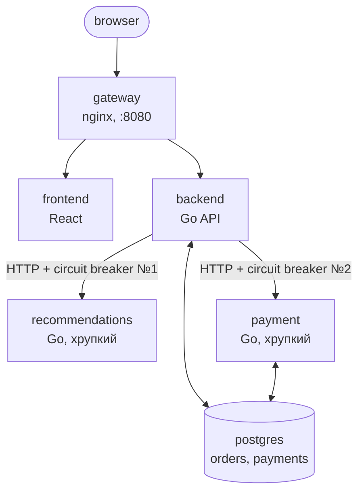

# SRE Observability Lab

Локальный стенд для работы с метриками, логами и трейcами в сервисном
приложении.

## Архитектура



Витрина умеет: смотреть каталог, открывать карточку товара (с
рекомендациями через circuit breaker), **добавлять товары в корзину** и
**оформлять заказ** ("Купить") — оформление идёт через `backend`, который
считает сумму по ценам из БД и обращается к `payment` (тоже через
отдельный circuit breaker) для списания денег.

| # | Сервис | Роль | Порт на хосте |
|---|---|---|---|
| 1 | `frontend` | React-витрина товаров, корзина, оформление заказа | (только через gateway) |
| 2 | `backend` | Go API: товары, карточка + рекомендации, оформление заказа (`/api/orders`) | `8081` |
| 3 | `postgres` | Хранилище товаров, заказов и платежей | `5432` |
| 4 | `recommendations` | Go, "хрупкая" зависимость для circuit breaker №1 | `8082` |
| 5 | `payment` | Go, "хрупкая" зависимость для circuit breaker №2 (оплата заказа) | `8083` |
| 6 | `grafana` | Дашборды и Explore для метрик/логов/трейсов | `3000` |
| 7 | `victoriametrics` | Хранилище метрик (Prometheus-совместимое) | `8428` |
| 8 | `tempo` | Хранилище трейсов (OTLP) | `3200`, `4317/4318` |
| 9 | `victorialogs` | Хранилище логов | `9428` |
| 10 | `gateway` | nginx, единая точка входа + X-Request-ID | `8080` |
| — | `vector` | Собирает stdout контейнеров → VictoriaLogs | — |

## Запуск

Нужен Docker и Docker Compose (v2). Сборка требует интернет — Go-модули,
npm-пакеты и образы качаются во время `build`.

```bash
docker compose up --build -d
docker compose ps        # все сервисы должны быть healthy/running
```

Открыть:

- **Витрина**: http://localhost:8080
- **Grafana**: http://localhost:3000 (admin/admin, но анонимный доступ тоже включён)
- **VictoriaMetrics UI** (vmui, /targets): http://localhost:8428
- **VictoriaLogs UI**: http://localhost:9428
- **Tempo** (обычно смотрят через Grafana, не напрямую): http://localhost:3200

Проверить, что стенд наполняется данными — открыть витрину и покликать
несколько товаров: это создаст трафик, который сразу увидят метрики, логи
и трейсы.

Некоторые настройки приложения доступны в админ-панели по адресу
http://localhost:8080/admin/. Панель предназначена только для локального
стенда.

> **Важно для новой схемы БД:** в `db/init.sql` добавлены таблицы
> `users`, `reviews`, `stock_movements` и колонка `stock` (а также seed-юзер
> `admin`). Поскольку `init.sql` исполняется только на пустой БД, при первом
> переносе на новую схему нужно **пересоздать volume**:
>
> ```bash
> docker compose down -v
> docker compose up --build -d
> ```

## Функционал стенда

У тестового стенда есть свои фичи со **своими метриками,
логами и трейсами**.

### Пользователи и сессии

- **Вход по имени без пароля.** Нажмите
  поле имени в шапке витрины, введите имя (например `admin` или `alice`) и
  «Войти». Backend выводит и сохраняет пользователя в таблицу `users`,
  заводит in-memory сессию и отдаёт токен; фронт хранит токен в
  `localStorage`.
- **Роли.** Готовый пользователь `admin` имеет роль `admin` и видит ссылку «⚙ Управление
  лабой». Любой другой пользователь получает роль `user` и этой ссылки не
  видит. Роль проверяется **на backend по in-memory сессии**, а не по одному
  заголовку: притвориться админом, просто прислав `X-User-Name: admin`, нельзя.
- **Авторизация админ-ручек:** без сессии → `401`; с сессией, но роль не
  `admin` → `403`. Прямые `/lab-admin/*` пути для не-админа отдают 401/403,
  ничего не «светя» наружу.
- **История покупок привязана к пользователю.** Каждый заказ хранит
  `user_id` покупателя. Страница «📋 История покупок» (`/history`) доступна
  только залогиненным (`401` анониму): **admin видит все заказы** и имя
  покупателя в каждом, **обычный пользователь — только свои**. Сам checkout
  (`POST /api/orders`) тоже требует входа (`401` без сессии), иначе некому
  приписать покупку.
- Метрики: `backend_user_logins_total`, `backend_active_sessions`,
  `backend_admin_denied_total`. События: `user_login`, `user_logout`,
  `admin_access_denied`. Операции: `session.create`, `session.delete`.

### Склад

- У товаров есть остаток `stock`; на витрине и в карточке видно
  «В наличии: N шт.» / «Нет в наличии». Кнопка «+ В корзину» для товара без
  остатка отключена.
- **Покупка списывает остаток.** В `checkout` перед оплатой выполняется
  `inventory.reserve`: если остатка не хватает — заказ **НЕ создаётся**
  (в отличие от payment-флоу, где заказ сохраняется всегда), ответ `409`.
- **Если оплата после резервирования не прошла** — остатки **возвращаются**
  на склад компенсирующим движением (`unreserve`). Оба движения пишутся в
  ledger `stock_movements` — это дополнительный источник наблюдаемости.
- **Restock** — только через админ-панель (раздел «📦 Склад (остатки)»);
  восполнение фиксируется движением `restock`.
- Метрики: `backend_stock_movement_total{reason=...}`,
  `backend_orders_blocked_by_stock_total`, `backend_low_stock_products`,
  `backend_inventory_restock_total`. События: `order_blocked_low_stock`,
  `inventory_restocked`. Операции: `inventory.reserve`, `inventory.restock`.

### Отзывы и рейтинги

- В карточке товара появился блок «⭐ Отзывы»: список, средний рейтинг и форма
  добавления. **Оставить отзыв можно только будучи залогиненным** (`401`
  анониму). Валидация: рейтинг 1..5 и непустой комментарий — иначе `400` и
  метрика отказов.
- Агрегированные `avg_rating`/`rating_count` приходят в ответах
  `/api/products` и `/api/products/{id}`.
- Метрики: `backend_reviews_posted_total`,
  `backend_reviews_rejected_total`, `backend_reviews_by_rating_total`.
  События: `review_created`, `review_failed`. Операции: `reviews.post`,
  `reviews.list`.

## Структура репозитория

```
gateway/                    nginx: reverse proxy + X-Request-ID
frontend/                   React SPA (Vite): каталог, корзина, checkout
backend/                    Go API: products, orders/checkout, users, inventory, reviews, observability
recommendations/            Go, "хрупкая" зависимость с /admin/chaos
payment/                    Go, "хрупкая" зависимость с /admin/chaos (оплата заказа)
db/init.sql                 схема + seed-данные: products, orders, order_items, payments, users, reviews, stock_movements
victoriametrics/            scrape.yml — конфиг скрейпинга
tempo/                      tempo.yaml — конфиг хранилища трейсов
vector/                     vector.yaml — сборщик логов → VictoriaLogs
grafana/                    provisioning датасорсов + готовый дашборд
```

## Известные ограничения

- Образы VictoriaMetrics/VictoriaLogs/Tempo/Vector/Grafana взяты с тегом
  `:latest` — для локального стенда это допустимо, но для воспроизводимой сборки стоит
  закрепить конкретные версии в `docker-compose.yml` под ваше окружение.
- Один экземпляр каждого сервиса.
- Нет ретеншена/бэкапов у VictoriaMetrics/VictoriaLogs/Tempo — это локальный стенд,
  данные хранятся в docker volumes без ограничения места на диске.
- Grafana открыта с анонимным admin-доступом — никогда не делайте так
  вне локального стенда.
- Если после `docker compose up --build` Grafana не видит датасорсы —
  подождите 10-15 секунд после старта (первичная установка плагинов
  VictoriaMetrics/VictoriaLogs для Grafana идёт при старте контейнера) и
  перезагрузите страницу.
- Корзина живёт только в state React (без персистентности) — это
  сознательное упрощение, чтобы не городить авторизацию/сессии в
  локальном стенде. Сохраняется в БД уже результат оформления — заказ.
- Сессии пользователей живут **in-memory** в backend: перезапуск backend
  «разлогинивает» всех (повторный вход — по имени). Сами пользователи,
  отзывы и остатки при этом сохраняются в БД.
- `payment` пишет в ту же Postgres, что и `backend` (таблица `payments`,
  отдельная от `orders`) — в реальной системе это была бы отдельная БД
  отдельного сервиса, здесь общий инстанс ради простоты стенда.

## Остановка и очистка

```bash
docker compose down          # остановить, оставить данные в volumes
docker compose down -v       # остановить и стереть все данные (метрики/логи/трейсы/БД)
```
